# Wedding Planner

Eine eigene Hochzeitsseite mit Verwaltung, die du selbst betreibst. Deine Gäste sagen online zu oder ab und laden am Hochzeitstag ihre Fotos hoch, du behältst Gästeliste, Sitzplan, Aufgaben und Kosten im Blick. Alles läuft in einem einzigen Docker-Container, die Daten bleiben bei dir.

*English in short: a self-hosted wedding website with RSVP, guest photo sharing (QR code per part of the day, shared gallery, ZIP download) and a planning back office (guest list, seating plan, to-dos, budget). One Docker container, SQLite, no external services. The interface is in German.*

## So sieht es aus

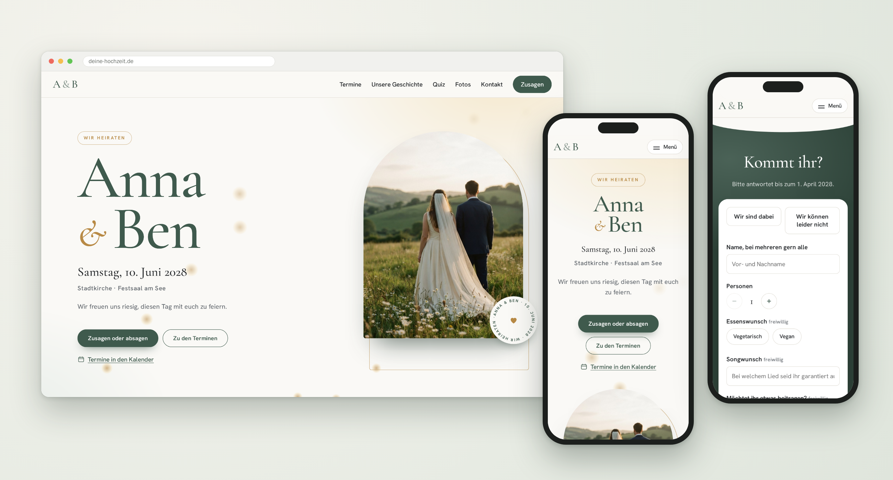

## Fotos von allen Gästen an einem Ort

Nach der Hochzeit hat jeder Gast ein paar gute Bilder, aber niemand hat alle. Hier laden deine Gäste ihre Fotos direkt auf eure Seite hoch. Ohne App, ohne Konto und ohne Cloud eines Fremdanbieters: Die Bilder landen auf deinem eigenen Server.

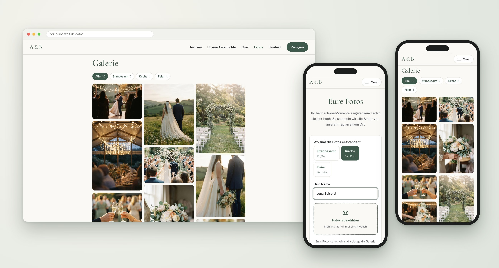

**So läuft es ab**

1. Du druckst für jeden Abschnitt des Tages (Standesamt, Kirche, Feier oder was ihr selbst anlegt) einen Aufsteller mit eigenem QR-Code.
2. Gäste scannen den Code, tragen ihren Namen ein und wählen ihre Fotos aus, auch viele auf einmal. Der Abschnitt ist schon vorausgewählt.
3. Alle Bilder erscheinen sofort in einer Galerie, nach Abschnitten filterbar und mit Großansicht zum Durchblättern.
4. Danach lädst du alles mit einem Klick als ZIP herunter, sortiert in einen Ordner pro Abschnitt.

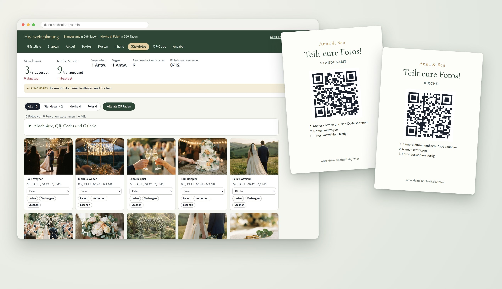

**Gut zu wissen**

- Der Browser verkleinert jedes Foto vor dem Hochladen und speichert es neu. Dabei fallen Aufnahmeort und Kameradaten weg.
- Jedes Foto wird beim Hochladen per Prüfsumme kontrolliert. Bei schlechtem Netz sendet die Seite bis zu viermal neu, das hilft auf Feiern mit schwachem Empfang.
- Du entscheidest, wann hochgeladen werden darf: Abschnitte lassen sich einzeln öffnen und schließen. Ohne QR-Code wählt die Fotoseite am Hochzeitstag automatisch den Abschnitt, der gerade dran ist.
- Die Galerie kannst du für Gäste ausschalten, dann siehst nur du sie in der Verwaltung.
- Du entscheidest, wer an die Fotoseite kommt: jeder mit dem Link oder nur mit dem QR-Code vom Tisch. Im zweiten Fall steckt ein geheimer Schlüssel im Code, ohne ihn bleiben Galerie und Hochladen zu. Auf dem Aufsteller steht der Code zusätzlich zum Abtippen, und du kannst ihn jederzeit erneuern.
- Du kannst Fotos in einen anderen Abschnitt verschieben, verbergen oder löschen.
- Ein passender Absatz in der Datenschutzerklärung ist schon dabei.
- Die Fotos liegen getrennt von den Daten der Seite in `/data/gaestefotos/<abschnitt>/`.

<details>
<summary>Weitere Ansichten der Fotofunktion</summary>

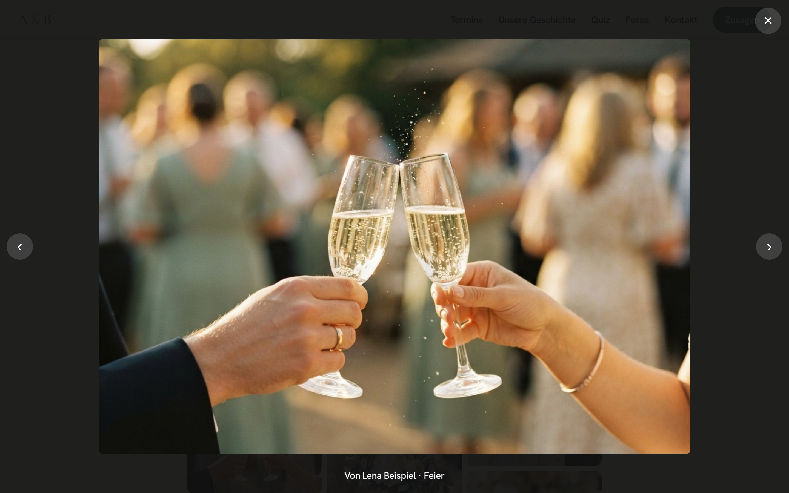

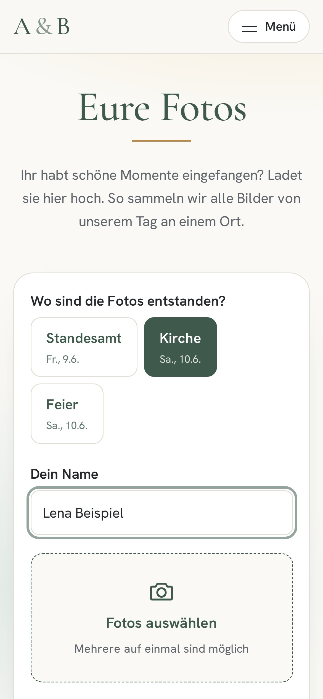

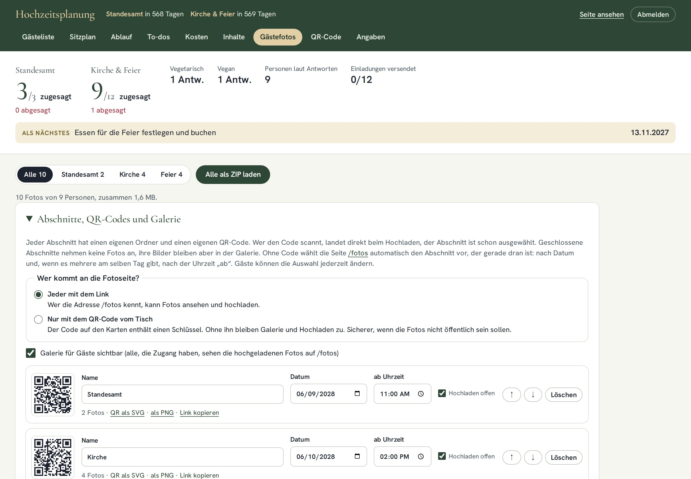

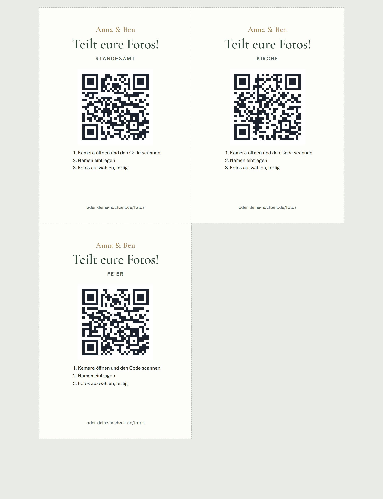

</details>

## Verwaltung

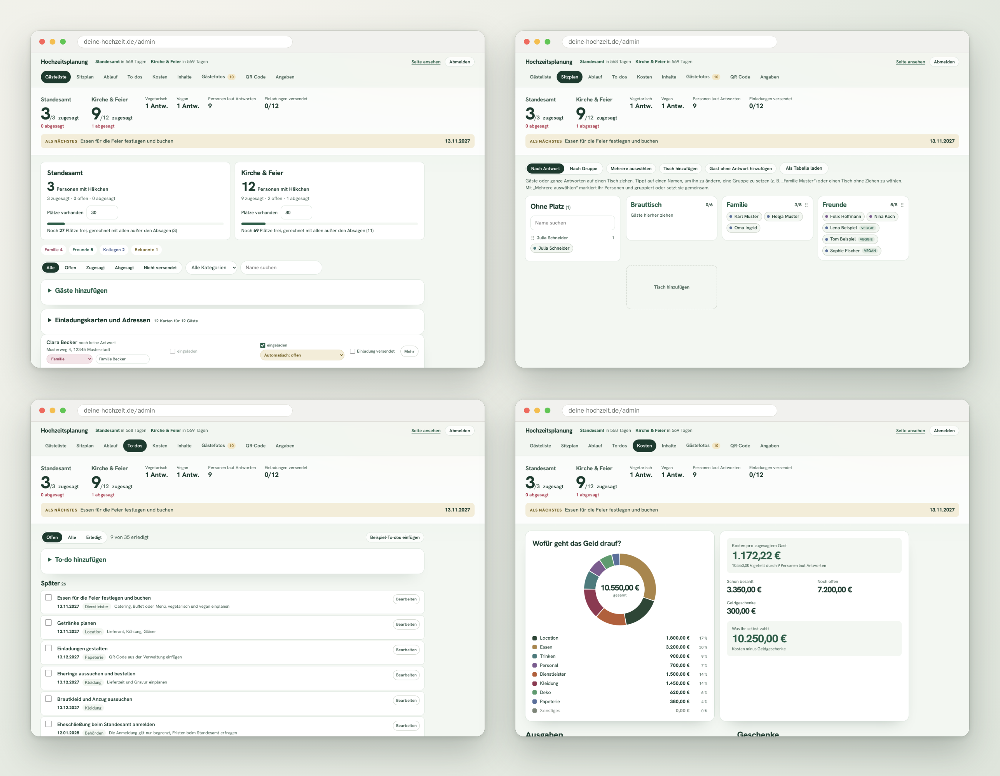

<details>
<summary>Weitere Ansichten</summary>

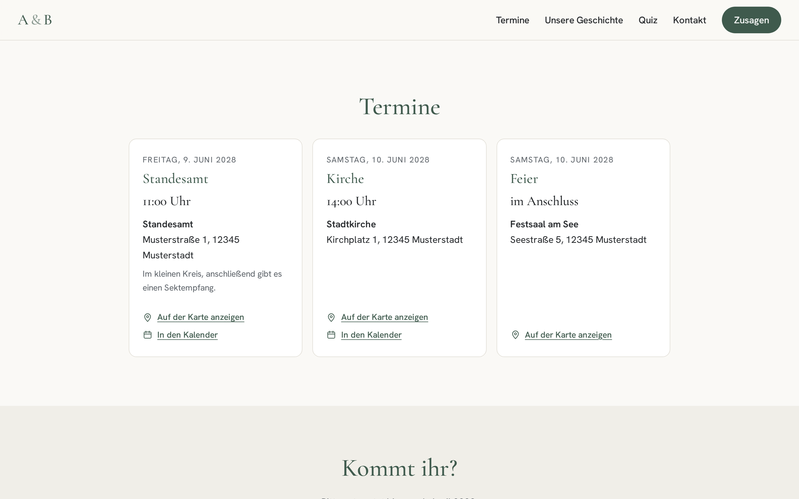

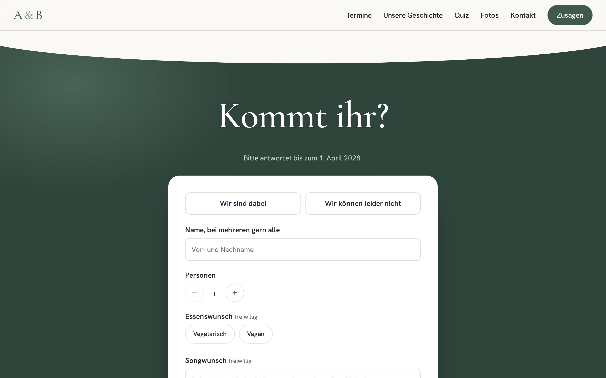

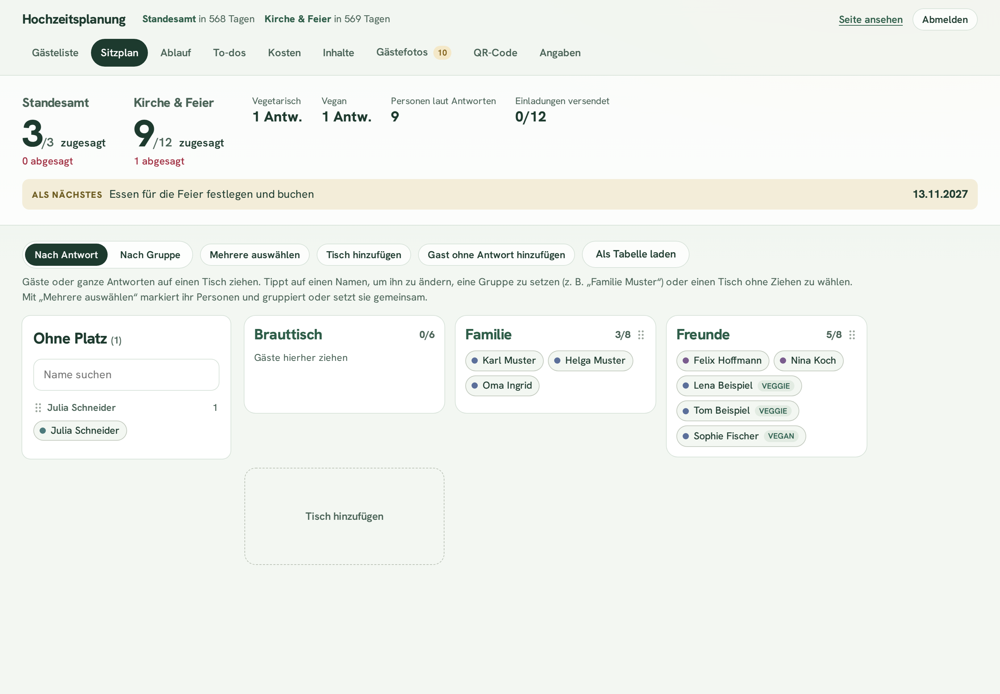

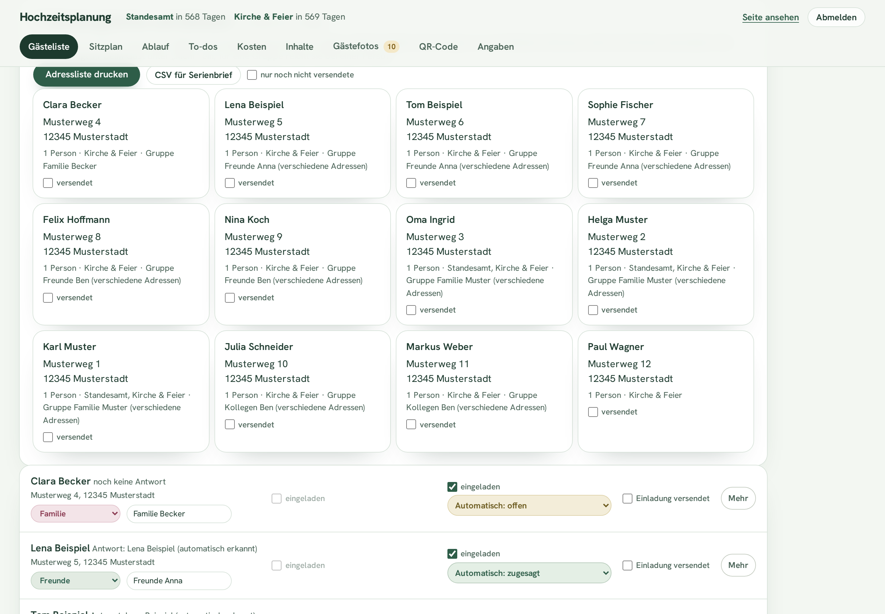

</details>

Die Bilder zeigen Beispieldaten, das Paar auf dem Titelbild und alle Galeriefotos sind gezeichnet. Das Design der Gästeseite ist bewusst schlicht gehalten, damit du es leicht an euren Stil anpassen kannst.

## Was drin ist

**Für die Gäste**
- **Fotos teilen:** Bilder vom Hochzeitstag per QR-Code hochladen, sortiert nach Abschnitten wie Standesamt, Kirche und Feier, mit gemeinsamer Galerie (siehe oben)
- Startseite mit Namen, Terminen, Karten-Links und Kalenderdatei (.ics)
- Zu- und Absage mit Personenzahl, Mitkommenden und Essenswunsch (vegetarisch, vegan)
- Seiten für Geschichte, Quiz, Kontakt, Impressum und Datenschutz
- Funktioniert auf dem Handy, keine Cookies, keine Fremdanbieter, Schriften liegen lokal

**Für euch (unter `/admin`)**
- Gästeliste mit Kategorien, Gruppen, Adressen und automatischem Abgleich mit den Antworten
- Einladungskarten pro Gruppe, mit Druckliste und CSV für Serienbriefe
- Sitzplan mit Drag and Drop
- To-do-Liste mit Beispiel-Checkliste, die sich nach eurem Hochzeitsdatum richtet
- Kosten mit Diagramm, Kosten pro Gast und Geschenke
- Fotos, Geschichte und Quiz pflegen, QR-Code für die Einladung
- **Gästefotos:** Abschnitte mit Datum und Uhrzeit, eigener QR-Code und Druckvorlage zum Aufstellen pro Abschnitt, Galerie zum Verschieben, Verbergen und Löschen, Download als ZIP
- Farben der Gästeseite (Haupt-, Hintergrund- und Textfarbe) per Farbwähler ändern, ohne Programmieren
- Zwei bis sechs Zugänge, alle Angaben ohne Programmieren änderbar

## Schnellstart

Du brauchst nur [Docker](https://docs.docker.com/get-docker/).

```bash
mkdir hochzeit && cd hochzeit
curl -O https://raw.githubusercontent.com/Farbwind/wedding-planner/main/docker-compose.yml
docker compose up -d
```

Dann im Browser öffnen:

- Gästeseite: http://localhost:8080
- Verwaltung: http://localhost:8080/admin

Beim ersten Öffnen der Verwaltung wählst du einen Zugang (Standard: `Anna` und `Ben`) und legst dein Passwort fest. Die Namen änderst du in der `docker-compose.yml` bei `ADMIN_USERS`.

Ohne Compose geht es auch mit einem Befehl:

```bash
docker run -d --name hochzeit -p 8080:3000 -v hochzeit-daten:/data \
  -e PUBLIC_URL=http://localhost:8080 -e ADMIN_USERS="Anna,Ben" \
  ghcr.io/farbwind/wedding-planner:latest
```

## Als Erstes in der Verwaltung

1. Reiter **Angaben**: Namen, Termine, Orte, Kartenlinks, Antwortfrist, Kontakt und Texte eintragen. Ein Foto für den Anfang der Startseite hochladen. Unter **Farben** die Hauptfarbe passend zu eurer Einladung wählen.
2. **Impressum und Datenschutz** ausfüllen (Name, Anschrift, E-Mail). Ohne diese Angaben zeigt die Seite „Angaben folgen“.
3. Reiter **Inhalte**: die Beispiele für Geschichte und Quiz durch eure ersetzen.
4. Reiter **To-dos**: „Beispiel-To-dos einfügen“ legt eine Checkliste an, deren Fristen sich nach dem Hochzeitsdatum richten.
5. Reiter **QR-Code**: Code herunterladen und auf die Einladung drucken.
6. Reiter **Gästefotos**: Abschnitte prüfen (Datum und Uhrzeit „ab“), bis zur Hochzeit schließen und den Aufsteller mit den QR-Codes drucken. Ohne QR-Code wählt die Fotoseite automatisch den Abschnitt, der gerade dran ist.

## Einstellungen des Containers

| Variable | Bedeutung | Standard |
| --- | --- | --- |
| `PUBLIC_URL` | Adresse, unter der die Seite erreichbar ist (für QR-Code und Kalender) | `http://localhost:8080` |
| `ADMIN_USERS` | Zugänge zur Verwaltung, mit Komma getrennt | `Anna,Ben` |
| `ADMIN_PASSWORD` | Erstes Passwort für Zugänge ohne Passwort, mindestens 8 Zeichen | nicht gesetzt |
| `TZ` | Zeitzone | `Europe/Berlin` |

Alle Daten liegen im Volume `/data`: SQLite-Datenbank, Bilder der Website und, getrennt davon, die Fotos der Gäste in `/data/gaestefotos/<abschnitt>/`.

## Im Internet betreiben

- Stell einen Reverse Proxy mit HTTPS davor (zum Beispiel Caddy, Traefik, Nginx oder einen Cloudflare Tunnel) und setze `PUBLIC_URL` auf die echte Adresse.
- Das erste Passwort lässt sich aus Sicherheitsgründen nur im eigenen Netzwerk festlegen. Auf einem Server im Internet setzt du es deshalb beim Start mit `ADMIN_PASSWORD`.
- Sichere das Volume regelmäßig. Ein Backup ist eine Kopie von `/data`:

```bash
docker run --rm -v hochzeit_daten:/data -v "$PWD":/backup alpine tar czf /backup/hochzeit-backup.tar.gz -C /data .
```

- Die Seite löscht alle Antworten automatisch nach dem Datum, das du unter **Angaben** bei „Antworten automatisch löschen nach“ einträgst. Lade vorher die Liste herunter, falls du sie noch brauchst.

## Aktualisieren

```bash
docker compose pull
docker compose up -d
```

Deine Daten bleiben erhalten.

## Mit einer KI anpassen

Texte, Termine und Fotos änderst du in der Verwaltung. Für ein anderes Aussehen oder neue Funktionen hilft dir ein KI-Modell mit Zugriff auf deinen Projektordner, zum Beispiel Claude Code, Cursor oder ChatGPT mit Dateizugriff.

1. Projekt herunterladen: `git clone https://github.com/Farbwind/wedding-planner.git`
2. Den Ordner im KI-Werkzeug öffnen.
3. Diesen Prompt einfügen und die Stellen in eckigen Klammern ausfüllen:

````text
Du hilfst mir, meine Hochzeitsseite anzupassen. Das Projekt ist der Open-Source "Wedding Planner"
(Node.js ohne Framework, kein Build-Schritt, Daten in SQLite, läuft in Docker).
Lies zuerst die Datei AGENTS.md im Projektordner. Dort stehen der Aufbau und die Regeln, an die du dich halten musst.

Über uns:
- Wir sind [Name 1] und [Name 2]. Wir heiraten am [Datum] in [Ort].
- Stimmung der Seite: [zum Beispiel romantisch und verspielt, modern und minimalistisch, rustikal, festlich]
- Farben: [zum Beispiel Salbei und Gold, Marineblau und Weiß]
- Schrift: [zum Beispiel elegante Serifenschrift für Überschriften, schlichte Schrift für Text]
- Wir haben diese Fotos: [Beschreibung oder Dateinamen, ich lege sie in public/img ab]

Das möchte ich ändern:
1. [zum Beispiel: Der Anfang der Startseite soll ein großes Foto über die ganze Breite haben]
2. [zum Beispiel: neue Seite "Anfahrt und Übernachtung"]
3. [weitere Wünsche]

Regeln:
- Ändere nur, was ich verlange. Die Verwaltung unter /admin lässt du in Ruhe, außer ich bitte dich darum.
- Texte auf der Seite sind auf Deutsch.
- Keine neuen Abhängigkeiten, keine Frameworks, keine Schriften oder Skripte von fremden Servern (Datenschutz).
- Zähle nach jeder Änderung die VERSION in server.js hoch, sonst zeigen Browser die alte Fassung.
- Teste die Änderung: "docker compose up -d --build", dann http://localhost:8080 öffnen und prüfen,
  auch in schmaler Handy-Breite.

Erkläre mir am Ende in einfachen Worten, was du geändert hast und wie ich es starte.
````

4. Selbst gebautes Image starten: in der `docker-compose.yml` die Zeile `image:` löschen, die Zeile `# build: .` einkommentieren und dann `docker compose up -d --build` ausführen.

## Hinweise zu Recht und Datenschutz

Impressum und Datenschutzerklärung sind Vorlagen und keine Rechtsberatung. Sie gehen davon aus, dass die Seite auf einem eigenen Server läuft, keine Zugriffsprotokolle mit IP-Adressen führt und keine Fremdanbieter einbindet. Nutzt du einen Dienst wie Cloudflare, einen anderen Hoster mit Protokollen oder baust Neues ein, passe den Text unter `server.js` (Funktion `rechtsSeite`) an. Die Pflichtangaben trägst du unter **Angaben** ein.

## Für Entwickler

- `server.js` Server, Angaben, Antworten, Anmeldung, Kalender, Impressum und Datenschutz
- `inhalte.js` Fotos, Geschichte, Quiz, Sitzplan
- `planung.js` Gästeliste, To-dos, Kosten, Geschenke
- `seiten.js` Rahmen der Gästeseiten (Kopf, Menü, Fuß)
- `public/` Seiten, Stylesheets und Skripte, `public/seiten/*.html` sind die Inhalte der Gästeseiten

Mehr dazu in [AGENTS.md](AGENTS.md). Fehler und Wünsche gern als Issue melden. Lizenz: [MIT](LICENSE).
